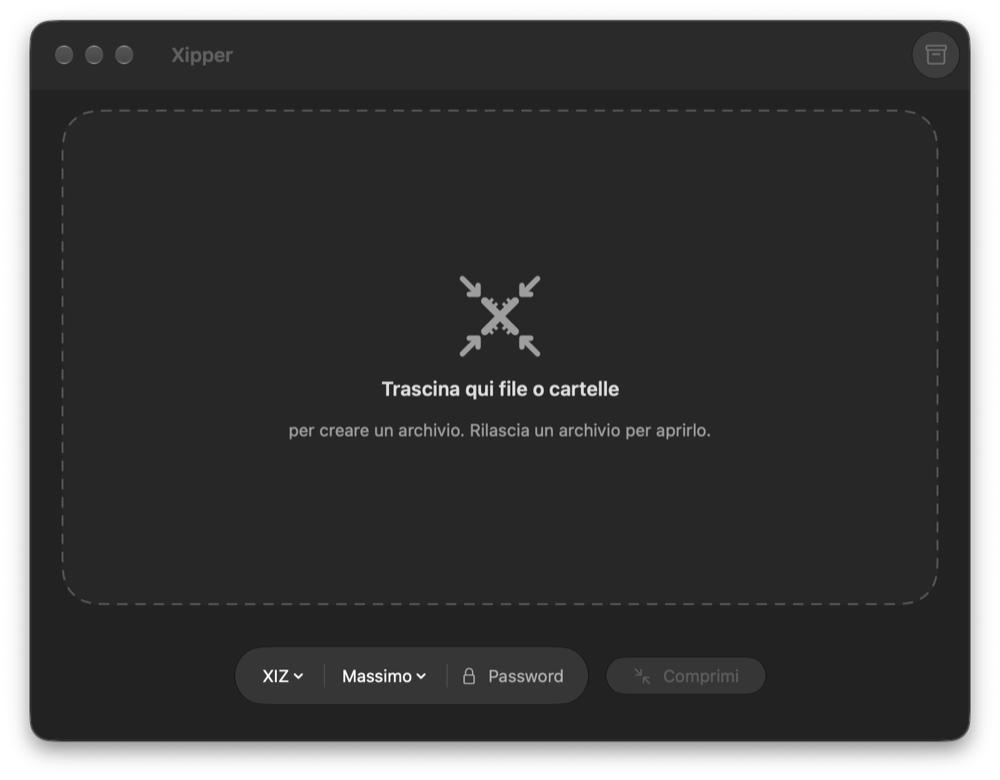
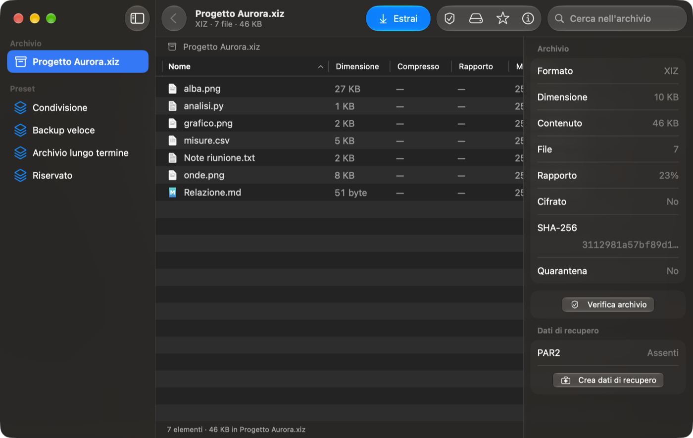
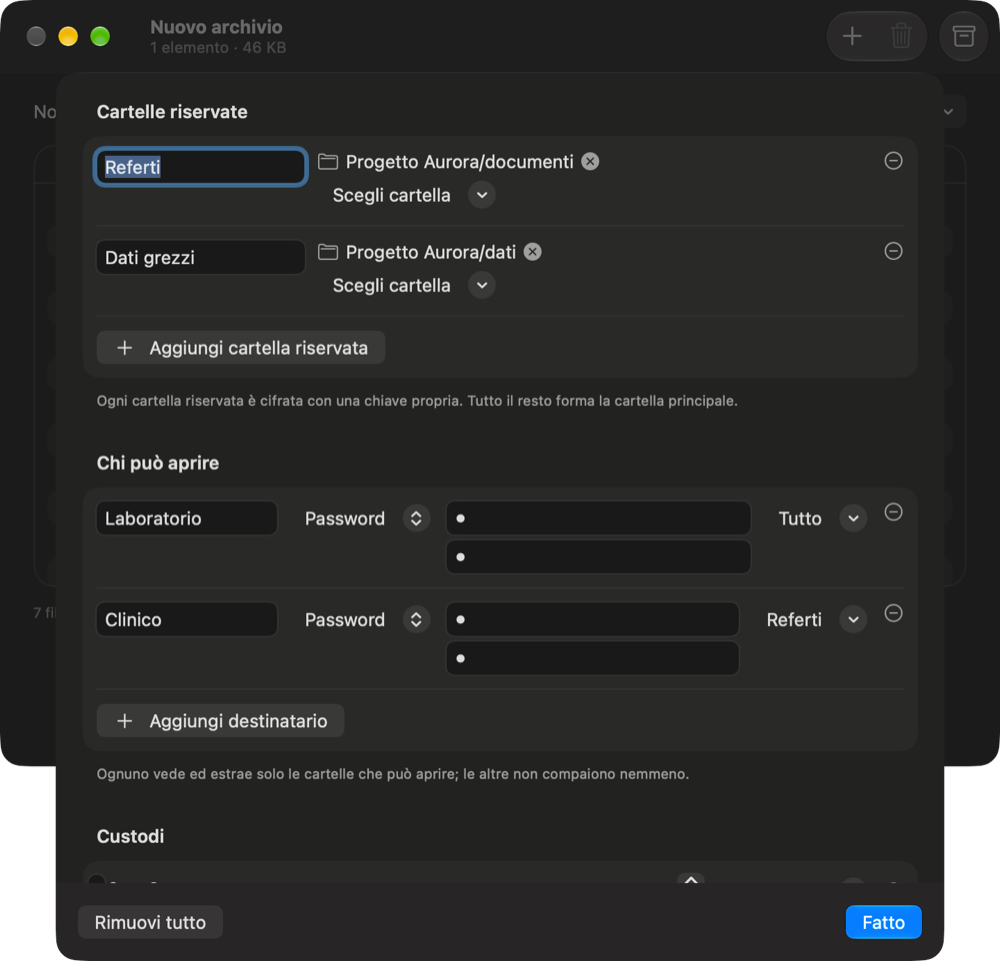
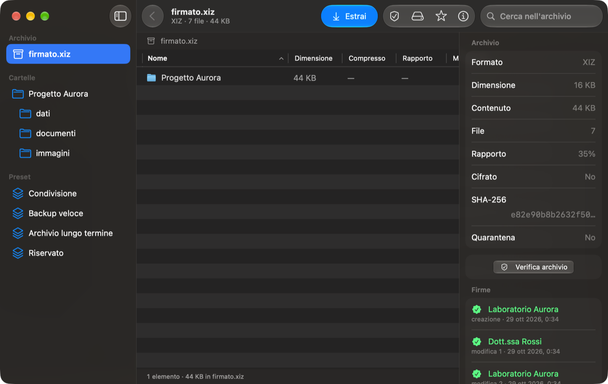

# Xipper

*Italiano · [English](README.en.md)*

Archiviatore nativo per macOS su Apple Silicon: crea, estrae, verifica e cifra archivi ZIP (anche bzip2, LZMA, xz, zstd, Deflate64 e a volumi), 7z, tar (gz, bz2, xz, zst, lz4, br), lz4, brotli, cpio, Apple Archive e XIZ, il formato di Xipper ([specifica](docs/XIZ_SPEC.md)); apre anche RAR e RAR5, compresi i RAR5 cifrati. Per la genomica converte BAM ↔ CRAM 3.1, scrive BGZF/bgzip e gli indici di samtools, bcftools e tabix, e verifica VCF/BCF/BAM/CRAM. Modifica gli archivi senza estrarli (ZIP, 7z e XIZ senza ricomprimere quello che non cambia) e li protegge con dati di recupero PAR2. Monta anche un archivio come volume, in lettura e scrittura: lo apri e lo modifichi nel Finder, e alla fine Xipper salva le modifiche nell'archivio. Non dipende da software di terzi a runtime: i codec open source sono compilati dentro l'app (vedi [Vendor/README.md](Vendor/README.md)).

- Studio di fattibilità e decisioni: [STUDIO.md](STUDIO.md)
- Spike delle prestazioni (fase 0): [SPIKE_FASE0.md](SPIKE_FASE0.md)
- Core e CLI (fase 1, con 7z della fase 3): [FASE1.md](FASE1.md)
- App SwiftUI (fase 2, in corso): [FASE2.md](FASE2.md) · specifica UI: [docs/UI_SPEC.md](docs/UI_SPEC.md)
- Beta per i tester: [docs/BETA_TESTERS.md](docs/BETA_TESTERS.md)
- Roadmap: [docs/ROADMAP.md](docs/ROADMAP.md)
- Specifica del formato XIZ: [docs/XIZ_SPEC.md](docs/XIZ_SPEC.md)
- Genomica: [studio XIZ per la genomica](docs/XIZ_GENOMICS_STUDY.md) · [disegno di XIG](docs/XIG_DESIGN.md) · [studio MPEG-G](docs/MPEGG_STUDY.md)

| Comprimi | Sfoglia, verifica, ripara |
|---|---|
|  |  |
| **Accesso per cartella (XIZ 1.3)** | **Cronologia firmata** |
|  |  |

## In breve

- **XIZ per dati sensibili** (XIZ 1.3, nell'app e da riga di comando), funzioni che nessun formato d'archivio comune ha:
  - **accesso per cartella:** più destinatari (password o chiave pubblica X25519), ciascuno vede ed estrae solo le sue cartelle; le altre non compaiono nemmeno;
  - **sblocco k-di-n:** una cartella si apre solo se, per esempio, 2 custodi su 3 sbloccano insieme (Shamir);
  - **cronologia firmata:** ogni modifica è firmata (Ed25519), concatenata alla precedente e, a richiesta, marcata temporalmente (RFC 3161); `xipper history` la verifica senza password;
  - **prova di un file:** si dimostra che un file appartiene all'archivio firmato senza consegnare il resto (albero di Merkle, RFC 6962), e chiunque la verifica con il solo file;
  - **cancellazione:** negli archivi creati come cancellabili ogni file ha la sua chiave; cancellarla rende il contenuto illeggibile in tutte le versioni dell'archivio (le copie fatte prima lo conservano);
  - **chiavi nel Portachiavi:** identità e chiavi di firma restano nel Portachiavi di macOS e si usano con Touch ID (Impostazioni › Chiavi); il comando `xipper` le usa con `keychain:NOME`.
- **Genomica:** CRAM 3.1 in lettura e scrittura, indici `.bai`/`.csi`/`.crai`/`.fai`/tabix, BGZF compatibile con `bgzip`; XIG, profilo genomico nativo di XIZ, è in fase di disegno.
- **Modifica senza estrarre** (ZIP, 7z e XIZ senza ricomprimere quello che non cambia), **dati di recupero PAR2** (anche con dati spostati), **montaggio come volume** in lettura e scrittura.

## Struttura

```
Package.swift            SwiftPM: codec C + XipperKit + CLI + test (macOS 26, arm64)
Vendor/                  zstd, libdeflate, liblzma, LZMA SDK, htscodecs, libarchive (RAR), lz4, brotli, Argon2 (sorgenti vendorizzati)
Sources/CXipShims/       wrapper C su zlib/bzip2 di sistema
Sources/XipperKit/       core Swift
  Xipper.swift           API pubblica: create / extract / test / list, riconoscimento del formato
  Zip/                   writer parallelo (ZIP64, AES-256, zstd), reader, estrazione e verifica parallele
  Tar/                   tar ustar/pax/GNU, cpio, Apple Archive, RAR (libarchive) con decifratura RAR5, streaming
  Xiz/                   XIZ: writer, reader, gruppi di accesso e destinatari, firme, prove, cancellazione
  Genomics/              CRAM 3.1, BAM, indici (tabix/CSI/BAI/CRAI/FAI), verifiche, manifest
  SevenZip/              7z: header, grafo dei coder, filtri BCJ/BCJ2, LZMA2 parallelo, volumi
  Codecs/                deflate, gzip/bzip2 paralleli, xz/zstd multi-thread, CRC-32
  Crypto/                WinZip AES (CTR little-endian su AES-ECB hardware), 7z AES-256-CBC, ZipCrypto (sola lettura)
  Extraction/            estrazione sicura comune a tutti i formati
  Mount/                 archivio montato come volume: albero copy-on-write, server WebDAV locale, NetFS
  Support/               concorrenza P/E-core, I/O, scansione delle sorgenti
Sources/xipper/          CLI
Tests/XipperKitTests/    interoperabilità, sicurezza, round trip
spike/                   codice e risultati della fase 0 e benchmark della fase 1
```

## Build e test

App (Xcode 27, macOS 26):

```bash
xcodebuild -project App/Xipper.xcodeproj -scheme Xipper -derivedDataPath .build/xcode build
```

Beta firmata (self-signed) con DMG in `dist/`:

```bash
scripts/release.sh beta1
```

Core e CLI:

```bash
swift build -c release
```

```bash
swift test
```

I test di interoperabilità usano `unzip`, `ditto`, `tar` e `python3` di sistema. Se è installato, usano anche `7zz` (Homebrew): servono solo ai test, non all'app.

## CLI

```bash
.build/release/xipper create foto.zip ~/Pictures/Vacanze
```

```bash
.build/release/xipper create -p segreto.zip documenti/
```

```bash
.build/release/xipper create -f tar.zst backup.tar.zst progetto/
```

```bash
.build/release/xipper create -p --volume 2g privato.7z archivio/
```

```bash
.build/release/xipper extract backup.tar.zst
```

```bash
.build/release/xipper test -p segreto.zip
```

```bash
.build/release/xipper list --long foto.zip
```

Modificare un archivio, riparare con PAR2:

```bash
.build/release/xipper edit foto.zip --delete vecchia.jpg --rename bozza:finale --add nuova.jpg:finale/nuova.jpg
```

```bash
.build/release/xipper par2 create --redundancy 10 foto.zip
```

```bash
.build/release/xipper par2 repair foto.zip.par2
```

Montare un archivio come volume (`/Volumes/<nome>`) finché non lo espelli o premi Ctrl-C. Le modifiche vengono salvate nell'archivio; con `--read-only` il volume è in sola lettura, con `--discard` le modifiche si scartano:

```bash
.build/release/xipper mount foto.zip
```

Genomica (BGZF, compatibile con `bgzip`):

```bash
.build/release/xipper bgzip -i varianti.vcf
```

```bash
.build/release/xipper bgzip --convert vecchio.vcf.gz
```

```bash
.build/release/xipper bgzip -t campione.bam
```

Indici tabix/CSI, verifica di VCF/BCF/BAM/CRAM e dei loro indici, manifest dei checksum:

```bash
.build/release/xipper tabix --bgzip varianti.vcf
```

```bash
.build/release/xipper index-check campione.cram varianti.vcf.gz
```

```bash
.build/release/xipper manifest create -o consegna.json dati/
```

```bash
.build/release/xipper manifest verify consegna.json
```

XIZ per dati sensibili: chiavi, politica di accesso, modifiche firmate, prove, cancellazione:

```bash
.build/release/xipper keygen -o ricerca.key
```

```bash
.build/release/xipper keygen --signing -o firma.key
```

```bash
.build/release/xipper create -f xiz --access politica.json --sign firma.key --signer "Laboratorio" caso.xiz caso/
```

```bash
.build/release/xipper list --identity ricerca.key caso.xiz
```

```bash
.build/release/xipper history caso.xiz
```

```bash
.build/release/xipper prove -p caso.xiz caso/referti/r1.pdf -o r1.prova.json
```

```bash
.build/release/xipper verify-proof r1.prova.json r1.pdf
```

```bash
.build/release/xipper erase -p --sign firma.key caso.xiz caso/referti/r1.pdf
```

Il file della politica (le password non ci stanno mai: `password_env` o `password_prompt`) è descritto in `xipper help` e in [docs/XIZ_SPEC.md §13](docs/XIZ_SPEC.md).

Server MCP per agenti AI (Claude Code, Claude Desktop):

```bash
claude mcp add --transport stdio --scope user xipper -- "$PWD/.build/release/xipper" mcp --allow ~/Documents
```

```bash
.build/release/xipper mcp bundle -o Xipper.mcpb
```

Uscita: `0` ok, `1` errore, `2` uso errato, `3` voci saltate o verifica fallita, `4` password mancante o errata, `130` annullato (Ctrl-C).

## Licenza

[MIT](LICENSE). Il codice in `Vendor/` mantiene la propria licenza: zstd BSD-3-Clause, libdeflate MIT, liblzma 0BSD, LZMA SDK pubblico dominio, htscodecs BSD-3-Clause, libarchive BSD-2-Clause, lz4 BSD-2-Clause, brotli MIT, Argon2 CC0/Apache-2.0 (vedi [Vendor/README.md](Vendor/README.md)).
